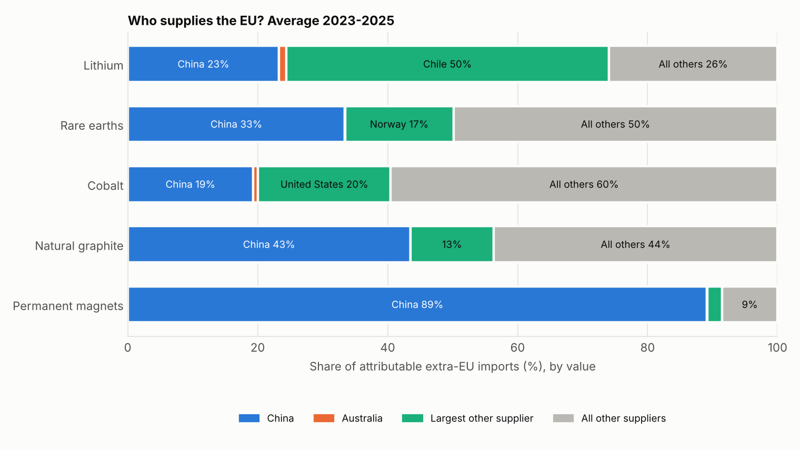
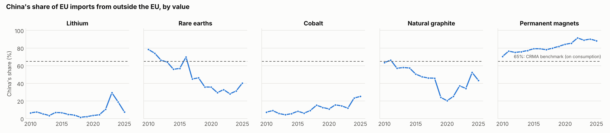
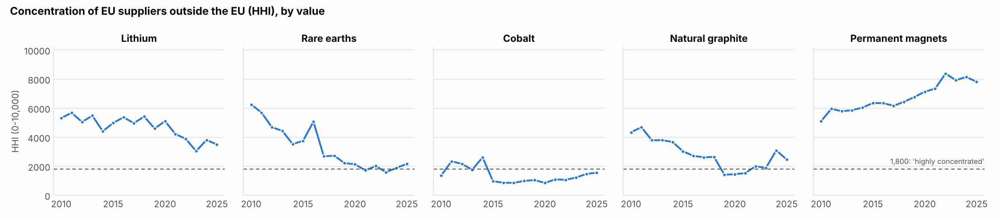
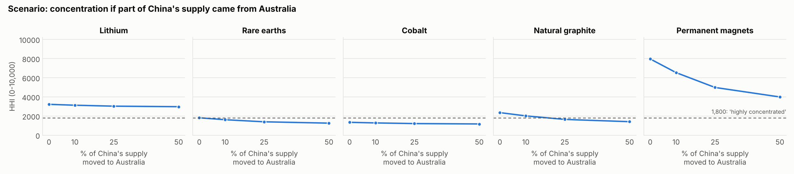

# EU dependence on critical raw materials: supplier concentration and an Australia scenario

*Generated by `run_analysis.py` from Eurostat data (last update 13/11/26 11:00:00).*

## Question

How dependent is the EU on a small number of non-EU suppliers for critical raw materials,
how has China's role changed since 2010, and how much would concentration fall if part
of China's supply came from Australia instead (for example, as a result of the EU-Australia
free trade agreement)?

## Data

- Source: Eurostat Comext, dataset DS-045409 (EU trade by HS6/CN8), annual, reporter EU27_2020
  (the current 27 members, applied to all years), imports, 2010-2025.
- Indicators: QUANTITY_IN_100KG, VALUE_IN_EUROS.
- Products (HS 6-digit), grouped into materials:
  - Lithium: 283691 (Lithium carbonates), 282520 (Lithium oxide and hydroxide)
  - Rare earths: 280530 (Rare-earth metals, scandium and yttrium), 284610 (Cerium compounds), 284690 (Other rare-earth compounds)
  - Cobalt: 810520 (Cobalt mattes, unwrought cobalt, powders), 282200 (Cobalt oxides and hydroxides)
  - Natural graphite: 250410 (Natural graphite in powder or flakes), 250490 (Natural graphite, other forms)
  - Permanent magnets: 850511 (Permanent magnets of metal)

Only imports from **outside the EU** are used. Partners that Eurostat reports as confidential or
not specified (codes QW, QZ) are excluded from the shares and reported separately.

## Data checks

- 15,544 rows read; no empty, non-numeric, negative or duplicated values.
- For every product, indicator and year (320 combinations), the country rows add up
  exactly to Eurostat's own extra-EU and intra-EU totals (0 mismatches).
- Material-years where more than 5% of extra-EU imports are confidential or unattributed:
  Lithium 2021 (6.6%), Rare earths 2016 (12.6%), Rare earths 2017 (11.4%), Natural graphite 2015 (6.8%), Natural graphite 2016 (6.4%), Natural graphite 2017 (5.3%).

## Key findings

- **Lithium**: China supplies 23.3% of attributable extra-EU imports in 2023-2025 (vs 6.5% in 2010-2012); by quantity 14.1% (vs 5.5%). The largest supplier is Chile (49.6%). HHI 3,222 (highly concentrated), like 3.1 equal-sized suppliers. Australia: 1.1%.
- **Rare earths**: China supplies 33.4% of attributable extra-EU imports in 2023-2025 (vs 72.1% in 2010-2012); by quantity 43.5% (vs 55.4%). China is the largest supplier. HHI 1,817 (highly concentrated), like 5.5 equal-sized suppliers. Australia: 0.0%.
- **Cobalt**: China supplies 19.3% of attributable extra-EU imports in 2023-2025 (vs 7.5% in 2010-2012); by quantity 16.6% (vs 1.9%). The largest supplier is United States (20.4%). HHI 1,345 (not highly concentrated), like 7.4 equal-sized suppliers. Australia: 0.8%.
- **Natural graphite**: China supplies 43.5% of attributable extra-EU imports in 2023-2025 (vs 62.7% in 2010-2012); by quantity 24.8% (vs 66.9%). China is the largest supplier. HHI 2,357 (highly concentrated), like 4.2 equal-sized suppliers. Australia: 0.0%.
- **Permanent magnets**: China supplies 89.1% of attributable extra-EU imports in 2023-2025 (vs 74.8% in 2010-2012); by quantity 92.1% (vs 84.5%). China is the largest supplier. HHI 7,964 (highly concentrated), like 1.3 equal-sized suppliers. Australia: 0.0%.

## Baseline: average 2023-2025, by value

HHI = sum of squared percentage shares (0-10,000). "Equivalent suppliers" = 10,000 / HHI.
For reference, the 2023 US Merger Guidelines call a market highly concentrated above 1,800.

| Material | Imports (EUR m/yr) | Suppliers | HHI | Equivalent suppliers | Largest supplier | China 2010-2012 | China 2023-2025 | Australia 2023-2025 | HHI by quantity | China by quantity |
|---|---|---|---|---|---|---|---|---|---|---|
| Lithium | 305 | 26 | 3,222 | 3.1 | Chile (49.6%) | 6.5% | 23.3% | 1.1% | 3,490 | 14.1% |
| Rare earths | 117 | 48 | 1,817 | 5.5 | China (33.4%) | 72.1% | 33.4% | 0.0% | 3,210 | 43.5% |
| Cobalt | 291 | 46 | 1,345 | 7.4 | United States (20.4%) | 7.5% | 19.3% | 0.8% | 1,250 | 16.6% |
| Natural graphite | 116 | 48 | 2,357 | 4.2 | China (43.5%) | 62.7% | 43.5% | 0.0% | 2,129 | 24.8% |
| Permanent magnets | 1,169 | 115 | 7,964 | 1.3 | China (89.1%) | 74.8% | 89.1% | 0.0% | 8,498 | 92.1% |

## Trends 2010-2025

Full yearly tables: `yearly_by_value.csv`, `yearly_by_quantity.csv`.

## Scenario: part of China's supply comes from Australia

Mechanical what-if on the 2023-2025 shares: a fraction of China's imports is reassigned to
Australia, total imports unchanged. It is not a forecast and says nothing about whether
Australian producers could supply these quantities, at what price, or in which processed form.

| Material | Shift | HHI | China | Australia | Largest supplier | Largest share |
|---|---|---|---|---|---|---|
| Lithium | 0% | 3,222 | 23.3% | 1.1% | Chile | 49.6% |
| Lithium | 10% | 3,130 | 21.0% | 3.4% | Chile | 49.6% |
| Lithium | 25% | 3,031 | 17.5% | 6.9% | Chile | 49.6% |
| Lithium | 50% | 2,976 | 11.7% | 12.7% | Chile | 49.6% |
| Rare earths | 0% | 1,817 | 33.4% | 0.0% | China | 33.4% |
| Rare earths | 10% | 1,616 | 30.1% | 3.4% | China | 30.1% |
| Rare earths | 25% | 1,399 | 25.1% | 8.4% | China | 25.1% |
| Rare earths | 50% | 1,259 | 16.7% | 16.7% | Australia | 16.7% |
| Cobalt | 0% | 1,345 | 19.3% | 0.8% | United States | 20.4% |
| Cobalt | 10% | 1,281 | 17.4% | 2.7% | United States | 20.4% |
| Cobalt | 25% | 1,213 | 14.5% | 5.6% | United States | 20.4% |
| Cobalt | 50% | 1,174 | 9.7% | 10.4% | United States | 20.4% |
| Natural graphite | 0% | 2,357 | 43.5% | 0.0% | China | 43.5% |
| Natural graphite | 10% | 2,017 | 39.1% | 4.4% | China | 39.1% |
| Natural graphite | 25% | 1,648 | 32.6% | 10.9% | China | 32.6% |
| Natural graphite | 50% | 1,411 | 21.7% | 21.7% | Australia | 21.7% |
| Permanent magnets | 0% | 7,964 | 89.1% | 0.0% | China | 89.1% |
| Permanent magnets | 10% | 6,534 | 80.2% | 8.9% | China | 80.2% |
| Permanent magnets | 25% | 4,985 | 66.9% | 22.3% | China | 66.9% |
| Permanent magnets | 50% | 3,992 | 44.6% | 44.6% | Australia | 44.6% |

### Distance from the benchmarks

The Critical Raw Materials Act (Regulation (EU) 2024/1252) aims for no single third country to
provide more than 65% of EU consumption of each strategic raw material by 2030. Consumption is not
the same as extra-EU imports, so the comparison below is only indicative.

| Material | China share now | Largest single supplier | Above 65%? | Shift needed for China <= 65% | Shift needed for HHI <= 1,800 |
|---|---|---|---|---|---|
| Lithium | 23.3% | Chile (49.6%) | no | already met | — |
| Rare earths | 33.4% | China (33.4%) | no | already met | 1% |
| Cobalt | 19.3% | United States (20.4%) | no | already met | already met |
| Natural graphite | 43.5% | China (43.5%) | no | already met | 18% |
| Permanent magnets | 89.1% | China (89.1%) | yes | 27% | — |

"—" means the target cannot be reached by moving supply from China to Australia alone.

## How to read these results (limitations)

1. **Imports are not consumption.** EU production, recycling and stocks are not included, and goods
   can be re-exported after import.
2. **Country of origin is the last processing country.** For example, rare-earth compounds refined
   in Malaysia count as Malaysian even if the ore was mined elsewhere. Upstream dependence can be
   larger or smaller than these shares suggest.
3. **Values move with prices.** Lithium prices rose sharply in 2022 and fell afterwards; quantity-based
   indicators are shown as a check.
4. **Quantities add different compounds** (e.g. lithium carbonate and hydroxide) by weight, not by
   metal content.
5. **HS6 codes are broad** for some materials (e.g. permanent magnets of metal include non-rare-earth
   magnets).
6. **The scenario is arithmetic**, not an economic model of trade diversion.
